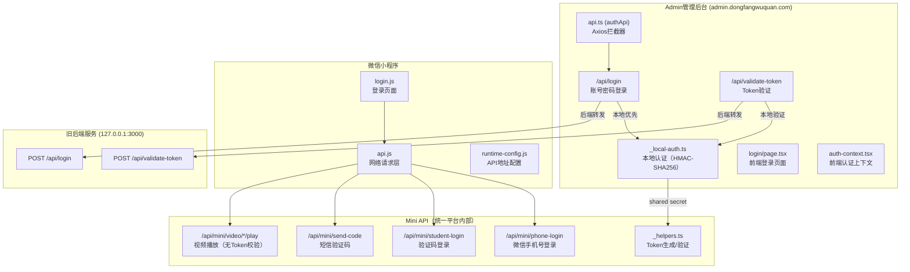
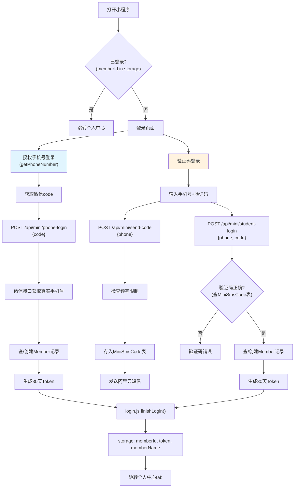

# 登录系统全面审计报告

> **审计日期：** 2026-06-02
> **审计范围：** Admin统一平台、微信小程序
> **审计人员：** 李小雷

---

## 目录

1. [系统架构概览](#1-系统架构概览)
2. [Admin管理后台审计（统一平台）](#2-admin管理后台审计统一平台)
3. [微信小程序审计](#3-微信小程序审计)
4. [关键API安全性对比](#4-关键api安全性对比)
5. [发现的问题汇总](#5-发现的问题汇总)
6. [修复建议](#6-修复建议)

---

## 1. 系统架构概览



### Token类型对比

| Token类型 | 生成位置 | 适用系统 | 格式 | 过期时间 | 签名密钥 |
|-----------|----------|----------|------|----------|----------|
| Admin Local Token | `_local-auth.ts` | Admin后台管理 | `local.{payload}.{sig}` | 24小时 | `ADMIN_SESSION_SECRET` |
| Mini Member Token | `_helpers.ts` | 小程序/学员 | `{payload}.{sig}` | 30天 | `ADMIN_SESSION_SECRET` (fallback: `'mini-student-token'`) |

---

## 2. Admin管理后台审计（统一平台）

### 2.1 登录流程

```
用户输入账号密码 → POST /api/login
  → 检查username/password非空
  → 尝试本地登录 (localLogin)
    → 查User表 → 检查status='active'
    → 明文密码比较 → 生成local.{payload}.{sig} Token
    → 返回{token, user}
  → 本地失败 → 转发旧后端 POST {backend}/login
    → 成功后返回{token, user}
  → 前端存储token到localStorage (admin_token, token)
  → 前端存储user到localStorage (admin_user, userData)
  → 跳转/dashboard
```

### 2.2 关键文件审计

#### 文件：`src/app/api/login/route.ts`

| 项目 | 状态 | 说明 |
|------|------|------|
| 请求方法 | ✅ | POST ✅ |
| 参数校验 | ✅ | username/password均非空校验 |
| 错误返回 | ✅ | 400: 请输入账号和密码, 401: 账号或密码错误, 502: 登录服务返回异常 |
| 密码传输 | ⚠️ | 明文传输（依赖HTTPS） |
| 密码比较 | ❌ **P1** | 本地认证使用`password !== expectedPassword`纯文本比较，无bcrypt |

#### 文件：`src/app/api/_local-auth.ts`

| 项目 | 状态 | 说明 |
|------|------|------|
| Token签名算法 | ✅ | HMAC-SHA256 with timing-safe compare |
| Token过期 | ✅ | 24小时 (Date.now() + 86400000) |
| Token格式 | ⚠️ | 自定义格式 `local.{payload}.{sig}`，非标准JWT |
| 签名密钥 | ❌ **P0** | `getSessionSecret()` 读取 `ADMIN_SESSION_SECRET`，**若未配置则直接throw Error** |
| 本地认证启用条件 | ✅ | `ADMIN_LOCAL_AUTH=true` 或非生产环境 |
| 密码存储 | ❌ **P1** | **明文密码**存储在环境变量 `ADMIN_LOCAL_DEV_PASSWORD`，使用`!==`比较 |

#### 文件：`src/app/api/validate-token/route.ts`

| 项目 | 状态 | 说明 |
|------|------|------|
| 验证方式 | ✅ | 验证signature签名 + 过期时间 |
| 后端回退 | ✅ | 本地验证失败后转发旧后端 |
| 错误返回 | ✅ | 401: 未登录, 502: 验证失败 |

#### 文件：`src/lib/api.ts`（authApi）

| 项目 | 状态 | 说明 |
|------|------|------|
| Token存储键名 | ❌ **P2** | 同时使用 `admin_token`、`token`、`admin_refresh_token`、`userData`、`admin_user`、`legacy_student_token` |
| 401自动跳转 | ✅ | 响应拦截器自动跳转/login |
| Token从localStorage读取 | ⚠️ | XSS可窃取 |
| 同时登录旧学员系统 | ✅ | 后台异步尝试，错则warn |
| 刷新Token机制 | ❌ **P1** | 无refresh token机制，30天Token到期后必须重新登录 |

#### 文件：`src/app/login/page.tsx`

| 项目 | 状态 | 说明 |
|------|------|------|
| UI渲染 | ✅ | 完整的登录表单 |
| Loading状态 | ✅ | Button loading + 文字'登录中...' |
| 记住账号 | ✅ | localStorage记住用户名 |
| SSO Token | ❌ **P0 严重** | 从URL获取`ssoToken`直接写入localStorage，然后才去验证！ |
| 忘记密码链接 | ❌ **P2** | `<a style={{...}}>忘记密码？</a>` **无href属性**，点击无反应 |
| 密码最小长度 | ✅ | 校验`password.length < 4` |

> ⚠️ **SSO Token Injection：** 代码在第45-55行：
> ```typescript
> const ssoToken = params.get('ssoToken');
> if (ssoToken) {
>   localStorage.setItem('admin_token', ssoToken);
>   localStorage.setItem('token', ssoToken);
>   const fallbackUser = { username: '管理员', name: '管理员', role: 'admin' };
>   localStorage.setItem('admin_user', JSON.stringify(fallbackUser));
>   localStorage.setItem('userData', JSON.stringify(fallbackUser));
>   // 验证token有效性
>   authApi.validateToken().then(...).catch(() => {
>     authApi.clearAuth();  // 失败才清除！
>   });
> }
> ```
> SSO Token先写入localStorage，**然后才去验证**。虽然验证失败会清除，但存在时间窗口问题。而且fallbackUser是硬编码的管理员身份。

#### 文件：`src/lib/auth-context.tsx`

| 项目 | 状态 | 说明 |
|------|------|------|
| 启动时验证Token | ✅ | 加载时调用validateToken |
| Token过期检测 | ❌ **P1** | 无Token过期轮询机制 |

#### 文件：`middleware.ts`（不存在）

| 项目 | 状态 | 说明 |
|------|------|------|
| Next.js Middleware | ❌ **P0 严重** | **完全缺失**，无框架级别的路由保护 |

---

## 3. 微信小程序审计

### 3.1 登录流程图



### 3.2 关键文件审计

#### 文件：`/api/mini/phone-login/route.ts`（微信手机号登录）

| 项目 | 状态 | 说明 |
|------|------|------|
| 微信AccessToken | ✅ | 通过微信API获取 |
| 手机号解密 | ✅ | 通过微信API getuserphonenumber |
| 手机号校验 | ✅ | 正则 `/^1\d{10}$/` |
| Token生成 | ✅ | 调用 `memberToken()` |
| 开发环境绕过 | ⚠️ | `previewPhone` 在非生产环境可用 |

#### 文件：`/api/mini/student-login/route.ts`（验证码登录）

| 项目 | 状态 | 说明 |
|------|------|------|
| 手机号校验 | ✅ | 正则 `/^1\d{10}$/` |
| 验证码验证 | ✅ | 查MiniSmsCode表，检查used=0和过期时间 |
| 验证码使用后标记 | ✅ | `SET used=1` |
| 开发环境绕过 | ⚠️ | `MINI_LOGIN_DEV_CODE` 可绕过验证码 |
| Token生成 | ✅ | 调用 `memberToken()` |

#### 文件：`/api/mini/send-code/route.ts`（短信验证码发送）

| 项目 | 状态 | 说明 |
|------|------|------|
| 手机号校验 | ✅ | 正则 `/^1\d{10}$/` |
| 频率限制 - 每手机号 | ✅ | 60秒冷却时间 |
| 频率限制 - 每IP | ✅ | 最多5次/60秒 |
| 频率限制 - 存储 | ❌ **P0** | **内存Map存储**（`rateLimitMap`），服务器重启后重置 |
| 旧验证码作废 | ✅ | 发送前 UPDATE used=1 WHERE phone |
| 阿里云短信 | ✅ | 直接调用阿里云API |
| 短信签名不匹配 | ❌ **P2** | 代码默认 `湖南雷震子咨询`，但`.env.production`中为`东方舞圈` |
| 开发模式返回验证码 | ✅ | 返回devCode供测试 |

#### 文件：`_helpers.ts` (Token生成/验证)

| 项目 | 状态 | 说明 |
|------|------|------|
| Token格式 | ✅ | `{base64url(payload)}.{base64url(hmac)}` |
| 签名强度 | ✅ | HMAC-SHA256 + timing safe compare |
| 过期时间 | ✅ | 30天 |
| 密钥回退 | ❌ **P0 严重** | 回退到 `'mini-student-token'` **硬编码字符串** |
| verifyMemberToken | ✅ | 返回memberId，失败返回0 |
| getMemberId | ✅ | 从Authorization header提取并验证 |

#### 文件：`login.js`（小程序登录页）

| 项目 | 状态 | 说明 |
|------|------|------|
| 已登录自动跳转 | ✅ | 有memberId则跳转个人中心 |
| 手机号输入限制 | ✅ | 11位数字 |
| 验证码输入限制 | ✅ | 6位数字 |
| 倒计时 | ✅ | 60秒倒计时 |
| 登录Loading | ✅ | logging/phoneLogging状态控制 |
| 登录成功存储 | ✅ | memberId, token, memberName |
| 开发模式填充验证码 | ✅ | 自动填充devCode |

#### 文件：`api.js`（小程序网络层）

| 项目 | 状态 | 说明 |
|------|------|------|
| Token自动携带 | ✅ | `Authorization: Bearer ${token}` |
| 多重Fallback | ✅ | 支持primary + fallback API地址 |
| Login API特殊处理 | ✅ | 使用loginApiBase + 不携带Token |
| member_id参数传递 | ❌ **P1 严重** | 很多API通过query param传递member_id而非从token提取 |

### 3.3 未验证Token的API端点（严重漏洞）

以下API端点从请求参数/body中提取`member_id`，**未验证Token签名**：

| API | 文件 | 问题 |
|-----|------|------|
| `GET /api/mini/video/[id]/play` | `mini/video/[id]/play/route.ts:17` | ❌ **P0 严重** `toPositiveInt(new URL(request.url).searchParams.get('member_id'))` — 直接从query取member_id，无Token验证 |
| `POST /api/mini/notes` | `mini/notes/route.ts:30` | ❌ **P0 严重** `toPositiveInt(body.member_id)` — 从body取member_id，无Token验证 |
| `POST /api/mini/bookmarks` | `mini/bookmarks/route.ts:27` | ❌ **P0 严重** `toPositiveInt(body.member_id)` — 从body取member_id，无Token验证 |
| `POST /api/mini/checkins` | `mini/checkins/route.ts:9` | ❌ **P0 严重** `toPositiveInt(body.member_id)` — 从body取member_id，无Token验证 |
| `POST /api/mini/member/checkin` | `mini/member/checkin/route.ts:11` | ❌ **P0 严重** `getMemberId(...) || toPositiveInt(body.member_id)` — 允许绕过Token验证 |

---

## 4. 关键API安全性对比

### Admin API vs Mini API 认证方式

| 认证点 | Admin API | Mini API (大部分) | Mini API (视频播放等) |
|--------|-----------|-------------------|----------------------|
| Token传递 | Header `Authorization: Bearer {token}` | Header `Authorization: Bearer {token}` | 根本不验证Token |
| Token校验 | `verifyLocalToken()` | `getMemberId()` | 使用raw `member_id` query |
| 密钥 | `ADMIN_SESSION_SECRET` | `ADMIN_SESSION_SECRET \|\| 'mini-student-token'` | N/A |
| 过期检查 | `Date.now() > exp` | `Date.now() > exp` | N/A |

### Token格式对比

**Admin Token:**
```
local.{base64url({id,username,role,exp})}.{hmac-sha256(payload)}
```
前缀 `local.` 便于区分

**Mini Token:**
```
{base64url({id,memberId,phone,exp})}.{hmac-sha256(payload)}
```
无前缀，密钥回退到硬编码字符串

---

## 5. 发现的问题汇总

### P0 - 致命问题（6个）

| 编号 | 问题 | 文件 | 行号 | 详情 |
|------|------|------|------|------|
| 🔴 P0-1 | **视频播放API无Token验证** | `mini/video/[id]/play/route.ts` | 17 | `member_id`直接从URL query获取，任何人知晓memberId即可观看授权视频 |
| 🔴 P0-2 | **笔记创建API无Token验证** | `mini/notes/route.ts` | 30 | `member_id`从request body获取，未验证token签名 |
| 🔴 P0-3 | **书签创建API无Token验证** | `mini/bookmarks/route.ts` | 27 | `member_id`从request body获取，未验证token签名 |
| 🔴 P0-4 | **打卡创建API无Token验证** | `mini/checkins/route.ts` | 9 | `member_id`从request body获取，未验证token签名 |
| 🔴 P0-5 | **Mini Token签名密钥硬编码回退** | `mini/_helpers.ts` | 59 | `secret = process.env.ADMIN_SESSION_SECRET \|\| 'mini-student-token'` — 回退到源码可见的硬编码字符串 |
| 🔴 P0-6 | **SSO Token注入漏洞** | `login/page.tsx` | 45-55 | SSO Token从URL获取后先写入localStorage再验证，存在时间窗口 |

### P1 - 严重问题（6个）

| 编号 | 问题 | 文件 | 行号 | 详情 |
|------|------|------|------|------|
| 🟠 P1-1 | **缓存签到API允许Token绕过** | `mini/member/checkin/route.ts` | 11 | `getMemberId() \|\| toPositiveInt(body.member_id)` — 同时支持两种方式，降低安全性 |
| 🟠 P1-2 | **本地认证明文密码比较** | `_local-auth.ts` | 53-54 | `password !== expectedPassword` 使用纯文本比较，未使用bcrypt |
| 🟠 P1-3 | **无Next.js Middleware** | `middleware.ts` | N/A | 缺失中间层路由保护，路由安全完全依赖客户端 |
| 🟠 P1-4 | **无刷新Token机制** | `api.ts` / `_helpers.ts` | 全局 | Token到期后只能重新登录，无refreshToken刷新机制 |
| 🟠 P1-5 | **登录接口无失败次数限制** | `login/route.ts` | 全局 | 账号密码登录接口无暴力破解防护 |
| 🟠 P1-6 | **短信频率限制为内存Map** | `mini/send-code/route.ts` | 22-49 | 使用Map存储频率状态，服务器重启后重置，不支持分布式部署 |

### P2 - 体验与配置问题（5个）

| 编号 | 问题 | 文件 | 行号 | 详情 |
|------|------|------|------|------|
| 🟡 P2-1 | **忘记密码链接无href** | `login/page.tsx` | 171 | `<a>`标签无href属性，点击无反应 |
| 🟡 P2-2 | **短信签名与环境配置不匹配** | `send-code/route.ts` / `.env.production` | 142 | 代码默认`湖南雷震子咨询`，生产环境配的是`东方舞圈` |
| 🟡 P2-3 | **多Token键名混乱** | `api.ts` | 全局 | `admin_token`、`token`、`admin_refresh_token`等6个键名混用 |
| 🟡 P2-4 | **笔记/书签GET与POST认证不一致** | `notes/route.ts`, `bookmarks/route.ts` | 对比 | GET用`getMemberId()`验证token，POST却用`body.member_id` |
| 🟡 P2-5 | **生产环境ADMIN_SESSION_SECRET是否配置？** | `.env*` | N/A | 从.env文件未找到此配置，若缺失则getSessionSecret()直接throw |

---

## 6. 修复建议

### 紧急修复（P0 — 需立即处理）

#### P0-1~4: Mini API端点Token验证缺失

**建议：** 所有接收`member_id`的POST API统一使用`getMemberId()`方法从Authorization header提取并验证Token。

```typescript
// 错误做法 ❌
const memberId = toPositiveInt(body.member_id);

// 正确做法 ✅
const memberId = getMemberId(new URL(request.url).searchParams, request);
if (!memberId) return jsonError('未登录', 401);
```

**受影响文件：**
- `mini/video/[id]/play/route.ts` (最严重)
- `mini/notes/route.ts` (POST)
- `mini/bookmarks/route.ts` (POST)
- `mini/checkins/route.ts`
- `mini/member/checkin/route.ts`

#### P0-5: 移除硬编码签名密钥

**建议：** 移除`'mini-student-token'`回退值，强制要求`ADMIN_SESSION_SECRET`环境变量配置，并确保所有.env文件都包含此配置：

```typescript
// 在 .env / .env.production 中配置
ADMIN_SESSION_SECRET=<至少32位随机字符串>
```

#### P0-6: SSO Token处理流程修复

**建议：** 修改登录页面SSO处理逻辑，先验证Token再存储：

```typescript
// 先验证
if (ssoToken) {
  setLoading(true);
  localStorage.setItem('admin_token', ssoToken); // 只存token用于验证
  try {
    const result = await authApi.validateToken();
    const user = result.user || fallbackUser;
    localStorage.setItem('admin_user', JSON.stringify(user));
    localStorage.setItem('userData', JSON.stringify(user));
    message.success('登录成功');
    router.push('/dashboard');
  } catch {
    localStorage.removeItem('admin_token');
    setLoading(false);
    message.warning('令牌已过期，请重新登录');
  }
}
```

### 重要修复（P1 — 需尽快处理）

#### P1-1: 统一Token校验方式

**建议：** 所有Mini API端点统一使用`getMemberId()`进行Token验证，移除`member_id`从body/query直接获取的通道。

#### P1-2: 密码安全性提升

**建议：** 引入bcrypt对密码进行哈希存储：
```bash
npm install bcryptjs
```
```typescript
import bcrypt from 'bcryptjs';
// 登录比较: bcrypt.compare(password, storedHash)
```

#### P1-3: 添加Next.js Middleware

**建议：** 创建`middleware.ts`实现路由级别保护：

```typescript
import { NextResponse } from 'next/server';
import type { NextRequest } from 'next/server';

export function middleware(request: NextRequest) {
  const { pathname } = request.nextUrl;
  // 保护管理后台路由
  if (pathname.startsWith('/api/') && 
      !pathname.startsWith('/api/login') && 
      !pathname.startsWith('/api/mini/public') &&
      !pathname.startsWith('/api/mini/phone-login') &&
      !pathname.startsWith('/api/mini/student-login') &&
      !pathname.startsWith('/api/mini/send-code')) {
    const token = request.headers.get('authorization');
    if (!token) {
      return NextResponse.json({ error: '未登录' }, { status: 401 });
    }
  }
  return NextResponse.next();
}
```

#### P1-4: 添加刷新Token机制

**建议：** 实现refreshToken机制，在Token过期前自动续期。

#### P1-5: 添加登录失败次数限制

**建议：** 实现账号锁定机制，5次失败后锁定15分钟。

#### P1-6: 短信频率限制改为数据库或Redis

**建议：** 将短信频率限制改为基于数据库或Redis，支持持久化和分布式部署。

### 体验优化（P2）

#### P2-1: 忘记密码链接添加功能

**建议：** 实现密码重置流程，或至少添加管理员联系方式。

#### P2-2: 短信签名统一

**建议：** 将代码默认值改为与生产环境一致的`东方舞圈`。

#### P2-3: Token存储键名统一

**建议：** 统一使用`admin_token`和`admin_user`，移除冗余key。

#### P2-4: 统一笔记/书签API认证方式

**建议：** GET和POST方法使用相同的认证方式（都使用`getMemberId()`）。

#### P2-5: 确认生产环境密钥配置

**建议：** 检查生产服务器`.env.production`是否包含`ADMIN_SESSION_SECRET`配置。

---

## 附录A：关键文件索引

| 文件 | 路径 | 核心功能 |
|------|------|----------|
| Admin登录路由 | `src/app/api/login/route.ts` | 管理员账号密码登录 |
| 本地认证 | `src/app/api/_local-auth.ts` | Token生成、验证、本地登录 |
| Token验证路由 | `src/app/api/validate-token/route.ts` | Token有效性验证 |
| Mini Phone登录 | `src/app/api/mini/phone-login/route.ts` | 微信手机号一键登录 |
| Mini验证码登录 | `src/app/api/mini/student-login/route.ts` | 短信验证码登录 |
| Mini短信发送 | `src/app/api/mini/send-code/route.ts` | 阿里云短信发送 |
| Mini工具函数 | `src/app/api/mini/_helpers.ts` | Token生成/验证/辅助函数 |
| 前端认证上下文 | `src/lib/auth-context.tsx` | React AuthProvider |
| 前端API层 | `src/lib/api.ts` | Axios实例 + 拦截器 |
| 登录页面 | `src/app/login/page.tsx` | 管理员登录页面 |
| 小程序登录JS | `pages/login/login.js` | 小程序登录逻辑 |
| 小程序登录WXML | `pages/login/login.wxml` | 小程序登录模板 |
| 小程序API层 | `utils/api.js` | 小程序网络请求层 |
| 小程序配置 | `shared/runtime-config.js` | API地址配置 |
| **漏洞**视频播放 | `mini/video/[id]/play/route.ts` | ⚠️ 无Token验证 |
| **漏洞**笔记创建 | `mini/notes/route.ts` | ⚠️ POST无Token验证 |
| **漏洞**书签创建 | `mini/bookmarks/route.ts` | ⚠️ POST无Token验证 |

---

## 附录B：名词对照

| 术语 | 说明 |
|------|------|
| Admin Local Token | 管理后台本地生成的Token，格式 `local.{payload}.{sig}` |
| Mini Member Token | 小程序学员Token，格式 `{payload}.{sig}` |
| SSO Token | 单点登录Token，通过URL参数 `ssoToken` 传递 |
| memberToken() | Mini学员Token生成函数（`_helpers.ts:126`） |
| verifyMemberToken() | Mini学员Token验证函数（`_helpers.ts:56`） |
| getMemberId() | 从Authorization header提取并验证member_id（`_helpers.ts:73`） |

---

*报告完毕 — 总计发现问题：6个P0 + 6个P1 + 5个P2*
